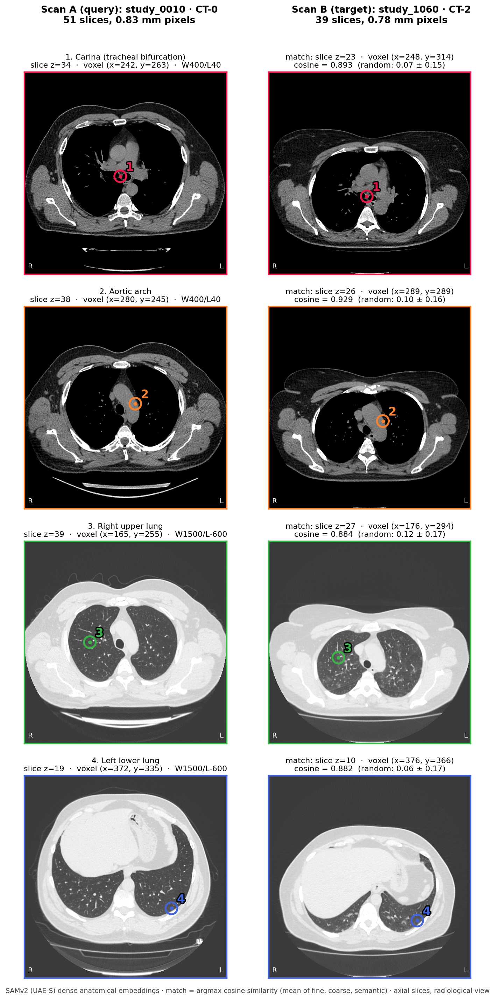

<div dir="rtl">

# משימת בונוס: התאמת נקודות ציון אנטומיות בין סריקות CT באמצעות SAMv2



## השיטה

**SAMv2** (UAE-S, מתוך [self-supervised-anatomical-embedding-v2](https://github.com/alibaba-damo-academy/self-supervised-anatomical-embedding-v2)) מפיק **Embedding אנטומי צפוף**: וקטור של 128 ממדים לכל voxel בסריקה. הוא מורכב משלושה ענפים:
- **fine:** ‏FPN מקומי ברזולוציה של 4 מ"מ;
- **coarse:** הקשר גלובלי;
- **semantic:** ענף שאומן עם מסכות איברים.

כדי למצוא בסריקה B נקודה שנבחרה בסריקה A, מחשבים Cosine Similarity בין ה-Embedding של נקודת השאילתה לבין ה-Embedding של כל voxel ב-B (ממוצע שלושת הענפים, כמו ב-`get_sim_embed_semantic_loc` הרשמי). ה-voxel עם הדמיון הגבוה ביותר הוא ההתאמה.

**התאמה לסביבה שלנו:** הקוד הרשמי דורש PyTorch 1.9, ‏mmcv 1.4.7 ו-mmdetection 2.20, שאינם תואמים ל-PyTorch 2.10 ול-CUDA 13 בקונטיינר. לכן מימשנו מחדש את ה-forward pass ב-PyTorch נקי (`src/samv2_model.py`):
- **ארכיטקטורה:** ‏ResNet3d-18 עם שלושה ראשי FPN3d, באותם שמות פרמטרים כמו במקור.
- **משקלים:** ‏`SAMv2_iter_20000.pth` הורד מ-ModelScope, אומת לפי SHA256 ונטען עם `weights_only=True` ו-`strict=True`. כל 146 הטנזורים תואמים בשם ובצורה.
- **Preprocessing:** כמו במקור: כיוון LPS, ‏Resampling ל-2×2×2 מ"מ, חיתוך ל-‎[-1024, 3071] HU, סקאלה ל-‎[0, 255] והחסרה של 50.
- **אימות נכונות:** בבדיקת self-matching (התאמת 20 נקודות אקראיות בסריקה A לסריקה A עצמה) השגיאה החציונית היא 3.2 מ"מ, בהתאם לרשת ה-fine של 4 מ"מ, והדמיון הממוצע בשיא הוא 0.97.

## הניסוי

| | Scan A (שאילתה) | Scan B (יעד) |
|---|---|---|
| מחקר | study_0010 | study_1060 |
| מחלקה | CT-0 (תקין) | CT-2 (‏25–50% מעורבות) |
| פרוסות | 51 | 39 |
| גודל פיקסל | 0.83 מ"מ (FOV של 425 מ"מ) | 0.78 מ"מ (FOV של 400 מ"מ) |

ארבע נקודות ציון נבחרו ידנית ב-Scan A. ערך ה-HU של כל אחת נבדק כדי לוודא שהיא בתוך רקמה ולא באוויר הרקע:
1. **Carina:** הרכס שבין שני הסמפונות הראשיים (‎-62 HU).
2. **Aortic arch:** קשת אבי העורקים (‎33 HU, דם).
3. **Right upper lung:** פרנכימה של האונה העליונה הימנית (‎-886 HU).
4. **Left lower lung:** פרנכימה אחורית של האונה התחתונה השמאלית (‎-879 HU).

**הסבר לעמודות בטבלה:**
- **Random:** ‏Cosine Similarity ממוצע ± סטיית תקן ל-5,000 voxels אקראיים בתוך הגוף ב-Scan B.
- **z-score:** כמה סטיות תקן ההתאמה גבוהה מהממוצע האקראי.
- **Cycle error:** מתאימים את הנקודה שנמצאה ב-B חזרה ל-A, ומודדים את המרחק מהשאילתה המקורית.

## תוצאות

| # | Landmark | A voxel (x,y,z) | B match (x,y,z) | Cosine | Random | z-score | Cycle error |
|---|---|---|---|---|---|---|---|
| 1 | Carina | (242, 263, 34) | (248, 314, 23) | **0.893** | 0.07 ± 0.15 | 5.5 | 2.6 מ"מ |
| 2 | Aortic arch | (280, 245, 38) | (289, 289, 26) | **0.929** | 0.10 ± 0.16 | 5.1 | 3.4 מ"מ |
| 3 | Right upper lung | (165, 255, 39) | (176, 294, 27) | **0.884** | 0.12 ± 0.17 | 4.5 | 4.2 מ"מ |
| 4 | Left lower lung | (372, 335, 19) | (376, 366, 10) | **0.882** | 0.07 ± 0.17 | 4.9 | 8.4 מ"מ |
| | **ממוצע** | | | **0.897** | **0.09** | | **4.7 מ"מ** |

**מה רואים:**
- **ההתאמות נכונות אנטומית בכל ארבעת המקרים** (ראו את האיור):
  - ה-Carina נמצא ב-B על הפרוסה שבה הקנה מתפצל.
  - נקודת ה-Aortic arch נמצאה בתוך אבי העורקים, לצד הקנה (דם, 29 HU).
  - שתי נקודות הריאה נמצאו באותה אונה ובאותו צד: ימנית עליונה, ושמאלית תחתונה אחורית מעל הסרעפת.
- **פער ברור בין ההתאמות לנקודות אקראיות:** ‏Cosine Similarity של 0.88–0.93 בהתאמות, לעומת כ-0.09 בנקודות אקראיות בגוף.
- **עקביות מחזורית טובה:** שגיאה ממוצעת של 4.7 מ"מ, כלומר בערך תא אחד ברשת ה-fine.
- **ההתאמה עמידה לשונות בין הסריקות:** הפרוסות המותאמות (z=23, 26, 27, 10) שונות לגמרי מאלה של A (z=34, 38, 39, 19). זה נובע מאורך כיסוי שונה (51 לעומת 39 פרוסות), ממיקום שונה של המטופל ומגודל גוף שונה. בנוסף, Scan B הוא CT-2, עם אטימויות בריאות.

## מגבלות

- **אין ground truth:** לא הייתה לנו אנוטציה של נקודות ציון ב-Scan B, ולכן הנכונות נבחנה ויזואלית ובעזרת מדדים עקיפים (HU, דמיון אקראי, cycle consistency), ולא כשגיאה במילימטרים מול אמת.
- **פרוסות עבות:** ב-MosMed כל פרוסה מכסה 8 מ"מ, כך שהדיוק בציר העומק מוגבל ל-±4 מ"מ לכל היותר. ה-Resampling ל-2 מ"מ הוא אינטרפולציה בלבד.
- **Cycle error גבוה יותר ב-Left lower lung (8.4 מ"מ):** פרנכימה ריאתית אחידה פחות ייחודית מבנים ברורים כמו ה-Carina, וזה תואם להערה במאגר הרשמי ש-SAM פחות מדויק באזורים בלי טקסטורה מבחינה.
- **הבדלי מימוש:** השתמשנו בהתאמת Nearest Neighbour הפשוטה, בלי ה-structural inference (`demo_semantic_stable_points.py`). ה-Resampling נעשה בטריליניארי של PyTorch ולא ב-torchio, כך שייתכנו הבדלים של פחות מ-voxel.

## שחזור

</div>

```bash
python src/demo_samv2.py   # downloads + SHA256-verifies the checkpoint if missing; GPU, ~1 s per scan
```
